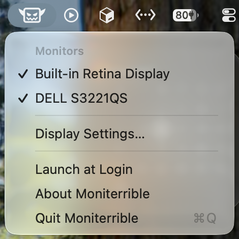
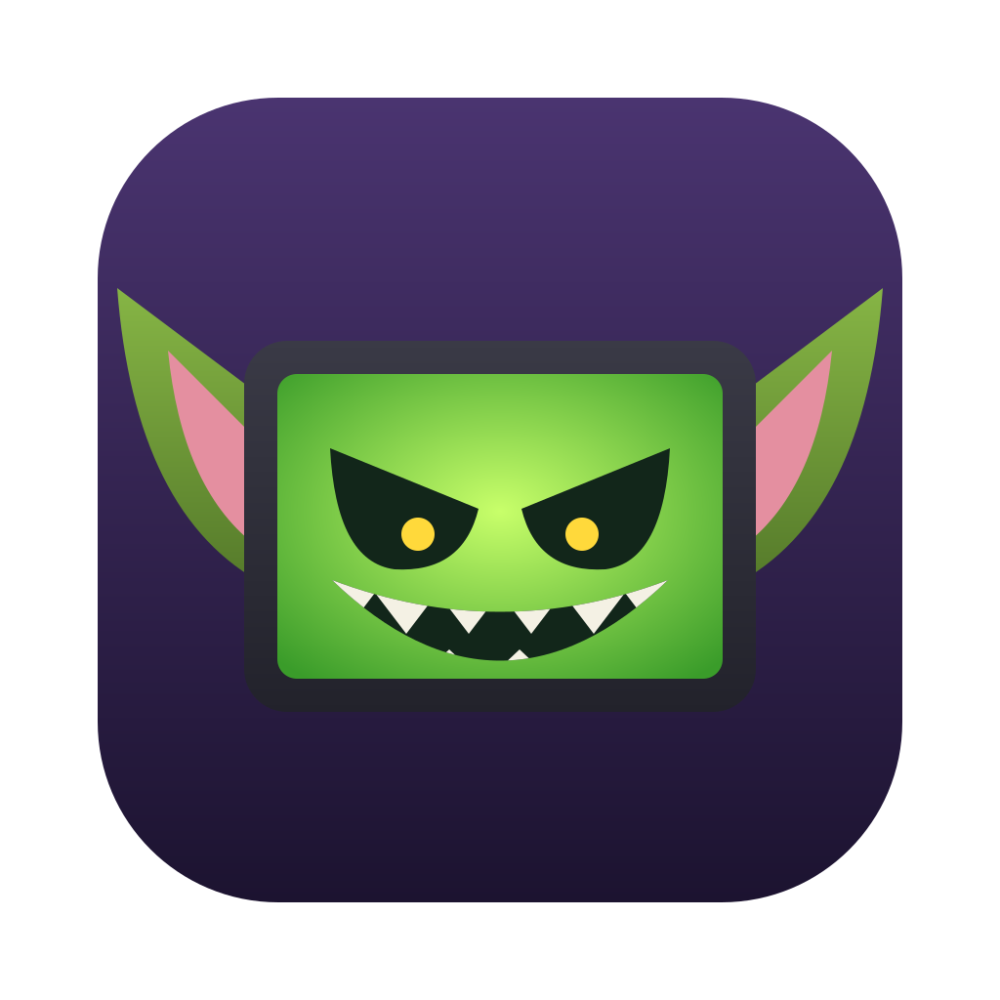

# Monitor Gremlin

A macOS menu bar app that connects and disconnects monitors without unplugging any cables.

Click the gremlin icon to see your monitors. A checkmark means the monitor is connected; click a monitor to flip it. Disconnecting a monitor makes macOS act as if it was unplugged, so windows move to your other screens.

A disconnected monitor stays in the menu so you can connect it again, including after quitting and reopening the app. If macOS gives a disconnected monitor a new ID, the menu finds it again by its model and serial number. If a monitor can't be reconnected, the menu shows the error. It keeps listing the monitor so you can try again, unless the monitor has been unplugged.

The menu also has a shortcut to Display Settings and a **Launch at Login** option.

## Download

Requires macOS 14 (Sonoma) or later.

1. Download the zip from the [latest release](https://github.com/haluska/MonitorGremlin/releases/latest) and unzip it.
2. Drag Monitor Gremlin to your Applications folder and open it.
3. The build is not notarized, so macOS blocks the first launch. Open System Settings > Privacy & Security, scroll to Security, and click **Open Anyway**.

## Build from source

Requires Xcode 26 or later.

1. Open `MonitorGremlin.xcodeproj` in Xcode.
2. Press **Cmd-R** to run. The gremlin appears in the menu bar (there is no window or dock icon).
3. Press **Cmd-U** to run the unit tests.

To stop the app, choose **Quit Monitor Gremlin** from its menu.

## How the code is organized

The app uses MVVM (Model–View–ViewModel).

| File | Role |
| --- | --- |
| `MonitorGremlin/MonitorGremlinApp.swift` | Entry point; creates the menu bar icon |
| `MonitorGremlin/Models/Display.swift` | One monitor (ID, name, connected or not) |
| `MonitorGremlin/Services/DisplayService.swift` | Lists monitors, connects and disconnects them, and remembers the disconnected ones. The macOS calls sit behind the `DisplaySystem` protocol |
| `MonitorGremlin/Services/PrivateDisplayAPI.swift` | The two private macOS function calls |
| `MonitorGremlin/Services/LoginItem.swift` | Registers the app to launch at login |
| `MonitorGremlin/ViewModels/DisplayMenuViewModel.swift` | Menu state and actions |
| `MonitorGremlin/Views/DisplayMenu.swift` | The menu's contents |
| `MonitorGremlin/Views/AboutPanel.swift` | The About window |
| `MonitorGremlinTests/` | Unit tests for the view model and the service, using fakes in place of the real monitors |

## How disconnecting works

macOS has no public API for disconnecting a monitor. Monitor Gremlin calls the undocumented `CGSConfigureDisplayEnabled` function, looked up at runtime in `PrivateDisplayAPI.swift`. Disconnected monitors are missing from the public display lists, so it also calls the undocumented `CGSGetDisplayList`, which still includes them.

Safety items:

- **You can't disconnect your last monitor.** That menu item is disabled.
- **Changes last only until you log out or restart.** If anything goes wrong, a restart brings all connected monitors back.

## License

MIT. See [LICENSE](LICENSE).

